# Updating the Aspose.PDF for AWS Client SDKs

How to support the client SDKs in this repository and update them when a new version of Aspose.PDF for AWS arrives.

- [Overview](#overview)
- [One-time setup](#one-time-setup)
- [When a new version of Aspose.PDF for AWS arrives](#when-a-new-version-of-asposepdf-for-aws-arrives)
- [Reviewing the result](#reviewing-the-result)
- [Committing, CI and publishing](#committing-ci-and-publishing)
- [Keeping hand edits](#keeping-hand-edits)
- [Troubleshooting](#troubleshooting)
- [Reference](#reference)

## Overview

The five client SDKs are generated, not written. To turn a new service version into new clients, export its OpenAPI spec and run `scripts/update-sdks.ps1`.

```mermaid
flowchart LR
    A["1 Service repo<br/>AsposePdfForAws checkout,<br/>pull the new version here"] --> B["2 Export the spec<br/>export-spec.ps1 builds and<br/>runs --export-swagger"]
    B --> C["3 spec/swagger.json<br/>committed source of truth;<br/>its diff is the API change"]
    C --> D["4 swagger-codegen 3.0.62<br/>one run per client,<br/>into a temp folder"]
    D --> E["5 Post-process and sync<br/>fixes for .NET and Java;<br/>ignored files are kept"]
    E --> F["6 Client folders<br/>dotnet, java, kotlin,<br/>php-cLient, typescript"]
    F --> G["7 Checks<br/>every endpoint present,<br/>every client builds"]
    G --> H["8 README.md<br/>service Generator, with<br/>examples from client docs"]
    H --> I["9 Commit and CI<br/>PR check fails on drift;<br/>push opens a regen PR"]
    style C stroke-width:3px
```



`scripts/update-sdks.ps1` runs steps 2 to 7. Add `-Readme` to include step 8. Step 9 is done by you and by CI. You only review step 3 by hand, because everything after it follows from the spec.

- **Service repo** (`D:\r\AsposePdfForAws`): the ASP.NET service whose `Aspose.Pdf.RestApi` project defines the API, plus `Aspose.Pdf.RestApi.Generator`, which writes the README.
- **SDK repo** (this repository): the spec, the generator settings, the scripts and the five clients (`dotnet-client`, `java-client`, `kotlin-client`, `php-cLient`, `typescript-client`).
- **Generated** files are overwritten on every run. **Hand-maintained** files are those listed in a client's `.swagger-codegen-ignore`. Lasting changes go only there, or into a post-process rule.

## One-time setup

A Windows machine with .NET and Git is enough. Everything else is optional or downloaded by the scripts.

| Tool | Needed for | Required? |
| --- | --- | --- |
| Windows PowerShell 5.1+ | All scripts in `scripts/` | Yes |
| .NET SDK 10 | Building the service, the README Generator and the .NET client | Yes |
| Git | Diffs, renames, commits | Yes |
| Java 21 | swagger-codegen, Java and Kotlin builds | No. If neither `JAVA_HOME` nor `java` on the PATH is found, the script downloads Temurin JDK 21 into `tools/` |
| Node.js 20 + npm | TypeScript compile check | No. Skipped with a warning if missing |
| PHP 8 on PATH | PHP syntax check (`php -l`) | No. Skipped with a warning if missing |

**Repositories.** Keep both checked out side by side:

- Service: `D:\r\AsposePdfForAws`. This is the default path; pass `-ServiceRepo <path>` if it lives elsewhere.
- SDKs: this repository. Run every command below from its root.

**Downloaded on first use.** These go into `tools/`, which Git ignores, and their checksums are verified:

- `swagger-codegen-cli-3.0.62.jar` from Maven Central.
- Temurin JDK 21, but only when no Java is installed.
- Gradle 8.5, fetched by the Java and Kotlin Gradle wrappers.
- Angular 17 packages for the TypeScript check, installed in `%TEMP%`.

The first run is noticeably slower because of these downloads.

**Execution policy.** PowerShell may refuse to run the scripts. If it does, call them as `powershell -ExecutionPolicy Bypass -File .\scripts\update-sdks.ps1 …`. Or allow local scripts once with `Set-ExecutionPolicy -Scope CurrentUser RemoteSigned`.

## When a new version of Aspose.PDF for AWS arrives

One command does the work: `.\scripts\update-sdks.ps1 -Version <x.y.z>`. The steps around it are for deciding what goes public and for reviewing the result.

1. **Update the service repo.** In `D:\r\AsposePdfForAws`, pull the new version and make sure it builds. The SDKs are generated from what this checkout exposes, so it must be exactly the released version.
2. **Decide which endpoints are public.** Every endpoint the service exposes ends up in all five SDKs. To keep one out, add a keyword from its path to `DisabledEndpoints` in `Aspose.Pdf.RestApi/Filter/DisableEndpointsAttribute.cs`. That removes it from the spec, and the service also returns 404 for it.
3. **Start a branch** in the SDK repo: `git switch -c sdk/<x.y.z>`.
4. **Run the update:**

    ```powershell
    .\scripts\update-sdks.ps1 -Version <x.y.z>
    ```

    The script does the following:
    - builds the service and exports the spec;
    - prints which endpoints and schemas were added (`+`), removed (`-`) or changed (`~`);
    - regenerates every client;
    - checks that all endpoints are present;
    - builds the clients.

    If it prints `Spec unchanged; nothing to do`, the API did not change and you are done.
5. **Read the output.** For each client the script prints how many files were added, updated, deleted and renamed. It also lists each deleted file (`-`) and each file renamed only by letter case (`~`). An unexpected deletion usually means a hand-written file that needs protecting (see [Keeping hand edits](#keeping-hand-edits)). Every check passed when the exit code is 0 and the last line is `All clients regenerated and verified`.
6. **Regenerate the README:**

    ```powershell
    .\scripts\update-sdks.ps1 -SkipExport -SkipBuild -Readme
    ```

    This runs the service's `Aspose.Pdf.RestApi.Generator`. It builds `README.md` from the spec and takes code examples from this repo's client docs. It also rewrites `Aspose.Pdf.RestApi/Docs/**` and `swagger.json` in the service repo, so review and commit those there.
7. **Review the diff** with the checklist in [Reviewing the result](#reviewing-the-result).
8. **Commit and push** (see [Committing, CI and publishing](#committing-ci-and-publishing)).

Useful variations:

- To refresh and inspect only the spec, run `.\scripts\export-spec.ps1`. It writes `spec/swagger.json` and prints the endpoint diff.
- To regenerate from the committed spec without touching the service, add `-SkipExport`.
- To regenerate even when the spec is unchanged (for example after editing `codegen/` or an ignore file), add `-Force`.
- To update one or a few clients, add `-Clients dotnet,java`.
- For a faster run without builds, add `-SkipBuild`. CI still builds everything.

## Reviewing the result

Review the diff of `spec/swagger.json` first. Every client change follows from it, so a change you accept there you accept in all five SDKs.

**What breaks existing SDK users.** Method and model names come from endpoint paths and parameter names, so a renamed path renames methods in every language. Watch for:

- Removed endpoints (for example `esign` and `form-filler` in October 2026).
- Renamed paths. For example, `verify_esign` became `verify-esign`, which renamed the request model and its methods.
- Removed or renamed parameters, and removed enum values.
- Changes to package names in `codegen/<client>.json` (`io.swagger`, `IO.Swagger`, `Swagger\Client`). These change every import.

**Choosing the version.** A suggested scheme, following semantic versioning:

| Change in the spec | Version bump |
| --- | --- |
| Endpoint, parameter or enum value removed or renamed | Major (x.0.0) |
| New endpoint, new optional parameter, new enum value | Minor (1.x.0) |
| Descriptions, examples, generator or build fixes only | Patch (1.0.x) |

`-Version` writes the version into the generated build files. The field it sets depends on the client:

- `artifactVersion` for Java (`pom.xml`, `build.gradle`), Kotlin and PHP;
- `npmVersion` for TypeScript;
- `packageVersion` for .NET.

It applies to that run only. To make a version the default, change the value in `codegen/<client>.json`. Two files are hand-maintained and need a manual edit: the .NET project file `dotnet-client/Aspose.Pdf.RestClient.csproj` and Kotlin's `kotlin-client/build.gradle`. `-Version` has not been used for a release yet, so check those files after the first time.

**Review checklist**

- [ ] The endpoint diff from `export-spec.ps1` matches the release notes of the new service version.
- [ ] Every new endpoint is meant to be public. If not, add it to `DisabledEndpoints` and rerun.
- [ ] Breaking changes are reflected in the version number.
- [ ] Each client's `docs/ApiApi.md` (PHP: `docs/Api/ApiApi.md`) lists the new methods with sensible names.
- [ ] Every deletion and rename printed by the script is expected.
- [ ] `git status` shows no changes to the hand-maintained files listed in [Keeping hand edits](#keeping-hand-edits).
- [ ] The script ended with `All clients regenerated and verified`. Any skipped build check (PHP, TypeScript) was run somewhere else or accepted.
- [ ] `README.md` shows the new endpoints and their examples.

## Committing, CI and publishing

Commit the spec, the regenerated clients and the README together. That way every commit on `main` has clients that match its spec.

```powershell
git add -A spec codegen scripts *-client php-cLient README.md
git commit -m "Update SDKs to Aspose.PDF for AWS <x.y.z>"
git push -u origin sdk/<x.y.z>
```

Then open a pull request into `main`. In the service repo, commit the README Generator's output (`Aspose.Pdf.RestApi/Docs/**`, `swagger.json`) separately.

**What CI does.** The workflow is `.github/workflows/sdk.yml`. It runs on a Windows runner with Java 21 and Node 20.

| Trigger | What happens |
| --- | --- |
| Pull request touching `spec/`, `codegen/`, `scripts/` or a client folder | Regenerates from the committed spec (`-SkipExport`), checks endpoints and builds. Fails if anything differs from the commit |
| Push to `main` touching the same paths | Same regeneration. If the result differs, opens a pull request from the branch `sdk/regenerate` |
| Manual run (Actions → SDKs → Run workflow) | Same as for a push. The optional `version` input is passed as `-Version` |

CI cannot reach the private service repo, so it never exports the spec. Refreshing `spec/swagger.json` is always a local step, with either `export-spec.ps1` or `update-sdks.ps1`.

A pull-request check that fails with *Generated clients are out of date* means the commit does not match what the spec generates. Run `.\scripts\update-sdks.ps1 -SkipExport` locally and commit the result. If the difference is a deliberate hand edit, move it into an ignore entry or a post-process rule instead.

**Publishing.** No package registry is configured: users take the clients from this GitHub repository, as the README links show. After merging, tag the release so users can pin it with `git tag v<x.y.z>` and `git push origin v<x.y.z>`. Publishing to NuGet, Maven Central, Packagist or npm is not set up; it would need package names other than the generator defaults.

## Keeping hand edits

Never edit generated files directly. The next regeneration overwrites them and the CI check fails. Put every deliberate change into one of two places:

| You need | Use | How it behaves |
| --- | --- | --- |
| A whole file that you maintain yourself | The client's `.swagger-codegen-ignore` | Never overwritten, never deleted. Same syntax as `.gitignore`: exact path, `*` wildcard, `dir/` for a folder |
| A small, repeatable change to generated files | A regex rule in `scripts/postprocess/<client>.ps1` | Runs on the fresh output before it is copied in, so it applies to every regeneration. Must be idempotent and case-sensitive (`-creplace`) |

To register a new post-process script, add `"postprocess": "scripts/postprocess/<client>.ps1"` to the client's entry in `codegen/codegen.json`. The script receives `-ClientDir <folder>`.

**Protected today**

| Client | Hand-maintained files | Why |
| --- | --- | --- |
| dotnet | `Aspose.Pdf.RestClient.csproj`, `src/main/CsharpDotNet2/IO/Swagger/Client/ApiClient.cs` | The generator emits no project file. `ApiClient.cs` was ported to RestSharp 110 by hand |
| java | `.gitignore` | Repo-specific ignores |
| kotlin | `build.gradle`, `gradlew`, `gradlew.bat`, `gradle/`, `src/main/kotlin/ApiTest.kt` | The generator emits no Gradle wrapper. The build was moved to Gradle 8.5 and Kotlin 1.9.24 for JDK 21 |
| php | `index.php`, `info.php`, `test.pdf` | Manual test files |
| typescript | `.npmignore` | Repo-specific ignores |

**Post-process rules today**

- `dotnet.ps1` ports the generated API and model files to RestSharp 110 (`RestResponse`, `Method.Post`, file uploads as `List<FileParameter>`).
- `java.ps1` sets Java 21 in `build.gradle`, `pom.xml` and the README. It also adds `javax.annotation-api` 1.3.2, which the generated code needs on Java 11 and later.

A protected file no longer gets generator improvements. If a codegen upgrade changes how `ApiClient` is called, update `ApiClient.cs` by hand.

**Adding a client language**

1. List the generators with `java -jar tools\swagger-codegen-cli-3.0.62.jar langs`.
2. Add an entry to `clients` in `codegen/codegen.json` with these fields: `name`, `generator`, `output` folder, `config`, `versionKey` and `sources` (the folder searched by the endpoint check). Add `postprocess` and `generatedSubdir` if needed.
3. Create `codegen/<name>.json` with the generator's options.
4. Run `.\scripts\update-sdks.ps1 -SkipExport -Clients <name>` and fix what it reports.
5. Add a build check for the new client to the `switch` in step 5 of `scripts/update-sdks.ps1`.
6. Add it to `Aspose.Pdf.RestApi/Docs/sdk.yaml` in the service repo, so the README shows its examples.

**Upgrading swagger-codegen**

1. Change `version`, `url` and `sha256` under `codegen` in `codegen/codegen.json`. Get the hash with `Get-FileHash <jar> -Algorithm SHA256`, and compare the jar's SHA-1 with the `.sha1` file on Maven Central.
2. Run `.\scripts\update-sdks.ps1 -SkipExport -Force` and expect a large diff.
3. Check that each post-process script still reports updated files and that every client builds. A rule that stops matching usually shows up as a build failure.

## Troubleshooting

Build logs are written to `%TEMP%\aspose-pdf-aws-sdk-build-<client>.log`. The script prints the path and the first error lines.

| Symptom | Likely cause | Fix |
| --- | --- | --- |
| `Service project not found under …` | The service repo is not at the default path | Pass `-ServiceRepo <path>` |
| `Service build failed` or `Spec export failed` | The new service version does not build, or lacks the `--export-swagger` switch | Fix the service build first. The switch lives in `Aspose.Pdf.RestApi/Program.cs` |
| `Spec unchanged; nothing to do` | The API did not change | Nothing to do. Use `-Force` after changing `codegen/` or an ignore file |
| `swagger-codegen failed for <client>` | Invalid spec or invalid `codegen/<client>.json` | Read the printed log tail. In JSON, backslashes must be doubled (`Swagger\\Client`) |
| `SHA-256 mismatch` | A broken download, or a wrong `url`/`sha256` in `codegen/codegen.json` | Delete the file in `tools/` and rerun. Recheck the hash |
| `MISSING <endpoints>` for a client | The generator skipped a path, or that client's `sources` folder is wrong | Look for the path in the client's API file. Fix `sources` in `codegen/codegen.json` |
| An unexpected `- <file>` deletion | A hand-written file that the generator does not produce | Run `git checkout -- <file>`, add the file to `.swagger-codegen-ignore` and rerun |
| `~ WebapiVerifyEsignBody.java -> WebapiVerifyesignBody.java` renames | The spec renamed a model only by letter case | Expected. The script fixes the Git index, so commit as is |
| Java build: `package javax.annotation does not exist` | The `java.ps1` rule no longer matches the generated build files | Update the regex in `scripts/postprocess/java.ps1` |
| Gradle: `Unsupported class file major version` | The Gradle wrapper is too old for the JDK | Raise the Gradle version in the client's wrapper properties (8.5 supports JDK 21) |
| .NET build errors about `IRestResponse` or `Method.POST` | The `dotnet.ps1` rule no longer matches | Update the regex in `scripts/postprocess/dotnet.ps1` |
| `php... skipped` or `typescript... skipped` | PHP or npm is not on the PATH | Install it, or rely on CI for that check |
| CI: *Generated clients are out of date* | The commit does not match the spec | Run `.\scripts\update-sdks.ps1 -SkipExport` and commit. Move hand edits to an ignore entry or a post-process rule |

## Reference

**Files in the SDK repo**

| Path | Purpose |
| --- | --- |
| `spec/swagger.json` | The OpenAPI spec every client is generated from |
| `codegen/codegen.json` | The pinned codegen and JDK (URL + SHA-256) and the list of clients |
| `codegen/<client>.json` | Generator options per client: package names, default version |
| `scripts/update-sdks.ps1` | The whole update: export, generate, sync, check, build, README |
| `scripts/export-spec.ps1` | Builds the service and exports its spec, printing the endpoint diff |
| `scripts/get-codegen.ps1`, `scripts/get-java.ps1` | Download and verify the codegen jar and, if needed, a JDK |
| `scripts/postprocess/*.ps1` | Fixes applied to generated code on every run |
| `<client>/.swagger-codegen-ignore` | The hand-maintained files of that client |
| `.github/workflows/sdk.yml` | CI: drift check on pull requests, regeneration PR on `main` |
| `tools/` | The downloaded jar and JDK (ignored by Git) |

**`update-sdks.ps1` parameters**

| Parameter | Default | Effect |
| --- | --- | --- |
| `-Version <x.y.z>` | Taken from `codegen/<client>.json` | Package version written into the generated build files |
| `-Clients a,b` | All five | Update only these clients (`dotnet`, `java`, `kotlin`, `php`, `typescript`) |
| `-ServiceRepo <path>` | `D:\r\AsposePdfForAws` | Where the service repo lives |
| `-SkipExport` | Off | Use the committed `spec/swagger.json` |
| `-Force` | Off | Regenerate even if the exported spec is unchanged |
| `-SkipBuild` | Off | Skip the build checks |
| `-Readme` | Off | Rebuild `README.md` with the service's Generator |

`export-spec.ps1` takes `-ServiceRepo`, `-Configuration` (default `Debug`) and `-NoBuild`. It returns `True` when the spec changed.

**Hooks in the service repo**

- `Aspose.Pdf.RestApi --export-swagger [path]` writes the spec and exits without starting the service, NATS or S3.
- `DisabledEndpoints` in `Aspose.Pdf.RestApi/Filter/DisableEndpointsAttribute.cs` lists path keywords that are hidden from the spec and the API.
- The `ASPOSE_PDF_SDK_DIR` environment variable points the README Generator at this repo's client docs. `-Readme` sets it.
- `Aspose.Pdf.RestApi/Docs/sdk.yaml` sets which clients appear in the README.

**Pinned versions**

| Component | Version |
| --- | --- |
| swagger-codegen-cli | 3.0.62 |
| JDK (downloaded only if none is installed) | Temurin 21.0.12.1+1 |
| Gradle (Java and Kotlin wrappers) | 8.5 |
| Kotlin | 1.9.24 |
| .NET client | net6.0, RestSharp 110.2.0, Newtonsoft.Json 13.0.3 |
| Java client target | Java 21 |
| TypeScript check | TypeScript 5.4.5, Angular 17.3.12, RxJS 7.8.1 |
